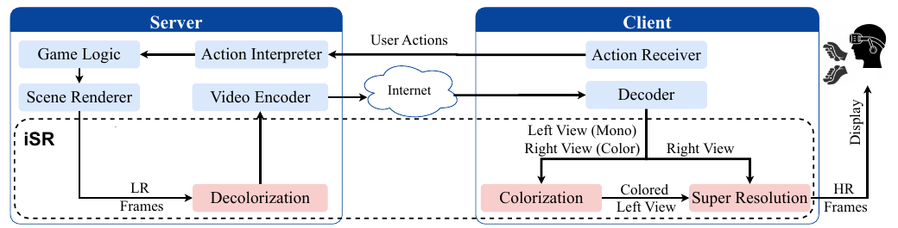
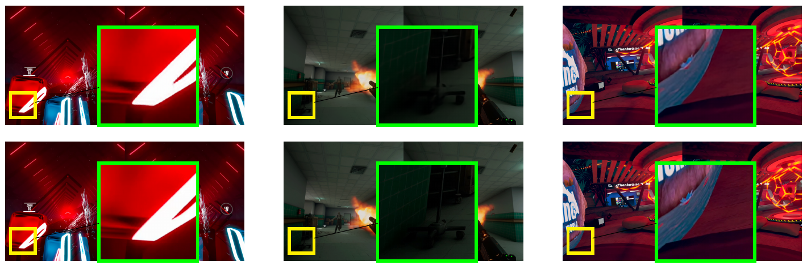

# iSR: Super-Resolution for Immersive Cloud VR Gaming Platforms

Official implementation of **iSR** (immersive Super-Resolution), published at the **ACM Multimedia Systems Conference (MMSys 2026)**, Hong Kong.

[Paper](https://doi.org/10.1145/3793853.3795746) · [Citation](#citation)



## Highlights

- **Up to 56% bandwidth savings** for 4K stereo VR streaming at the same perceptual quality
- **Real-time:** end-to-end latency within 1 to 2 ms of standard WebRTC streaming
- **High visual quality:** up to 40.2 dB PSNR and a user-rated MOS of up to 4.88 / 5
- **Easy to deploy:** no access to game source code, renderer data or eye-tracking hardware required

## Motivation

Cloud VR gaming lets players enjoy immersive games on lightweight headsets, but it shifts the cost from hardware to the network. Each frame carries two high-resolution views, streamed at high frame rates with a motion-to-photon budget of about 20 ms.

We measured bandwidth on the **Shadow PC** cloud VR platform using a **Meta Quest 3** across three games (Beat Saber, Pavlov VR and VRChat) streamed at 4K stereo. Median bitrates were **72 to 78 Mbps**.

Existing approaches don't fit this setting well:

- **Foveated rendering and encoding** need eye-tracking hardware and are sensitive to sudden gaze shifts.
- **Gaming upscalers** (DLSS, FSR, XeSS) need the game renderer's internal data, which only exists on the cloud server.
- **State-of-the-art stereo super-resolution** (CVHSSR) takes about 3 seconds per stereo frame, far too slow for interactive VR.

## How iSR Works

**Key insight:** in stereo VR, luminance carries the structural differences needed for depth perception, while chrominance is nearly identical between the two eyes. Sending color for both views is redundant.

**Server side**

1. Render both views at low resolution.
2. Remove the chrominance from the left view (decolorization), keeping only luminance.
3. Encode and stream with a standard codec (H.264, H.265 or AV1).

**Client side**

1. Decode the stream.
2. **Stereo-aware colorization** restores the left view's color using the right view as a reference.
3. **Super-resolution** upscales both views to the target resolution.
4. Merge the views into the final stereo frame for display.

Because iSR only adds a lightweight step before encoding and a GPU post-processing step after decoding, it can be added to existing cloud VR pipelines such as CloudXR, Shadow PC and Virtual Desktop without changing their rendering or compositor stages.

### Colorization module

A lightweight model based on SiCNet, the state-of-the-art stereo colorization network, optimized for real-time VR gaming:

- **Module pruning:** removed the Stereo Fusion and Stereo Consistency modules, which added latency for marginal quality gains in VR
- **Depthwise-separable convolutions:** reduced latency by nearly 20% with negligible quality loss
- **8-bit post-training quantization** of weights and activations: roughly halved the runtime

Feature-channel width is tuned per scale: 32 channels for ×4 and ×6, and 48 channels for ×8 and ×10.

### Super-resolution module

Uses **GameSR**, an efficient upscaling model designed for gaming content, with a residual-convolutional architecture, pixel-shuffle upsampling and a lightweight temporal component for smooth detail across frames.

## Results

### Bandwidth savings (Beat Saber, 4K, ×4 scaling)

| Quality level (VMAF) | Native 4K | iSR | Savings |
|---|---|---|---|
| Watchable (≥ 70) | 18 Mbps | 8 Mbps | **56%** |
| Good (≥ 80) | 24 Mbps | 12 Mbps | **50%** |
| Excellent (≥ 90) | Not reached up to 26 Mbps | 26 Mbps | |

### Visual quality across games (×4 scaling)

| Game | PSNR ↑ | SSIM ↑ | LPIPS ↓ | MOS (out of 5) |
|---|---|---|---|---|
| Beat Saber | 39.50 | 0.9835 | 0.0128 | 4.88 |
| Pavlov VR | 40.23 | 0.9789 | 0.0154 | 4.75 |
| VRChat | 37.18 | 0.9701 | 0.0283 | 4.25 |

MOS scores come from a user study with 8 participants. Even at ×8 and ×10 scaling, MOS stayed above 3.6 for all games.



*Left-eye frames from Beat Saber, Pavlov VR and VRChat at ×8 scaling. Top: iSR output. Bottom: ground truth.*

### Comparison with state-of-the-art super-resolution (×4)

| Model | Inference (ms) ↓ | PSNR ↑ | SSIM ↑ | LPIPS ↓ |
|---|---|---|---|---|
| **iSR (ours)** | **12.87** | **44.06** | **0.991** | **0.005** |
| CVHSSR | 2946 | 42.79 | 0.989 | 0.007 |
| EDSR | 105 | 39.74 | 0.978 | 0.012 |
| SwinIR | 1898 | 39.70 | 0.979 | 0.013 |

### Comparison with state-of-the-art colorization (×4)

| Model | PSNR ↑ | SSIM ↑ | LPIPS ↓ |
|---|---|---|---|
| **iSR (ours)** | **39.78** | **0.983** | **0.007** |
| SiCNet (pre-trained) | 21.03 | 0.526 | 0.120 |

SiCNet could not run on a 24 GB GPU due to its memory demand and took about 8 seconds per frame on CPU.

### Latency

In a real-time cloud gaming testbed ([GameLab](https://github.com/haseebfazal/ai-testbed)) streaming 2K stereo content, iSR at ×8 kept end-to-end latency at about **34 ms**, within 1 to 2 ms of standard WebRTC, while shrinking the encode and network portion by **2.5 to 3×**.

## Dataset

No public dataset had stitched stereo frames for these games, so we built one. Gameplay from **Beat Saber**, **Pavlov VR** and **VRChat** was recorded on a **Meta Quest 3** at its native resolution of **4128 × 2208**, using the headset's built-in recorder configured through Android Debug Bridge (adb), then converted into individual frames.

The games cover complementary challenges: fast motion and color-critical gameplay (Beat Saber), complex lighting and frequent viewpoint changes (Pavlov VR), and diverse user-generated visual styles (VRChat).

Ground-truth high-resolution images: [OneDrive link](DATASET_LINK)

## Requirements

Tested on:

- Ubuntu 22.04
- NVIDIA RTX A4000 (20 GB VRAM)
- Python 3, PyTorch 2.5.1, CUDA 11.8, cuDNN 9.1

Install dependencies:

```bash
pip install -r requirements.txt
```

## Repository Structure

| Module | Entry points |
|---|---|
| Colorization | `testquantization.py`, `stitch.py` |
| Super-resolution | `infer.py`, `config_ft.py` |

## Usage

The two modules run in sequence: colorization first, then super-resolution.

### 1. Colorization

#### Run inference

```bash
python testquantization.py --config 1 --ckp checkpoints/BeatSaber/scale8Channels48.pth
```

| Argument | Description |
|---|---|
| `--config` | Configuration ID |
| `--ckp` | Path to the model checkpoint. The example uses the Beat Saber model at ×8 scale with 48 channels. |

#### Prepare for stitching

1. Collect the generated `_out.png` images and the corresponding `_HR.png` images.
2. Place them in two separate folders:

   ```
   L/
   R/
   ```

3. Update the folder paths in `stitch.py`.

#### Stitch the stereo views

```bash
python stitch.py
```

### 2. Super-Resolution

#### Configure paths

Update the following variables in `config_ft.py`:

| Variable | Description |
|---|---|
| `infer_lr_image_path` | Path to the low-resolution input images |
| `infer_save_path` | Output folder for the results |
| `ground_truth_path` | Path to the ground-truth high-resolution images (see [Dataset](#dataset)) |

#### Run inference

```bash
python infer.py
```

## Citation

If you use this work, please cite:

```bibtex
@inproceedings{bakhtiariazad2026isr,
  title     = {iSR: Super-resolution for Immersive Cloud VR Gaming Platforms},
  author    = {Bakhtiariazad, Ghazaleh and Rehman, Haseeb Ur and Shirmohammadi, Shervin and Amer, Ihab and Hefeeda, Mohamed},
  booktitle = {Proceedings of the ACM Multimedia Systems Conference (MMSys '26)},
  pages     = {49--60},
  year      = {2026},
  address   = {Hong Kong},
  publisher = {Association for Computing Machinery},
  doi       = {10.1145/3793853.3795746}
}
```

## Authors

- **Ghazaleh Bakhtiariazad**, Simon Fraser University
- Haseeb Ur Rehman, University of Ottawa
- Shervin Shirmohammadi, University of Ottawa
- Ihab Amer, American University of Sharjah
- Mohamed Hefeeda, Simon Fraser University

Figures are from the paper, published under a [Creative Commons Attribution 4.0 International License](https://creativecommons.org/licenses/by/4.0/).
